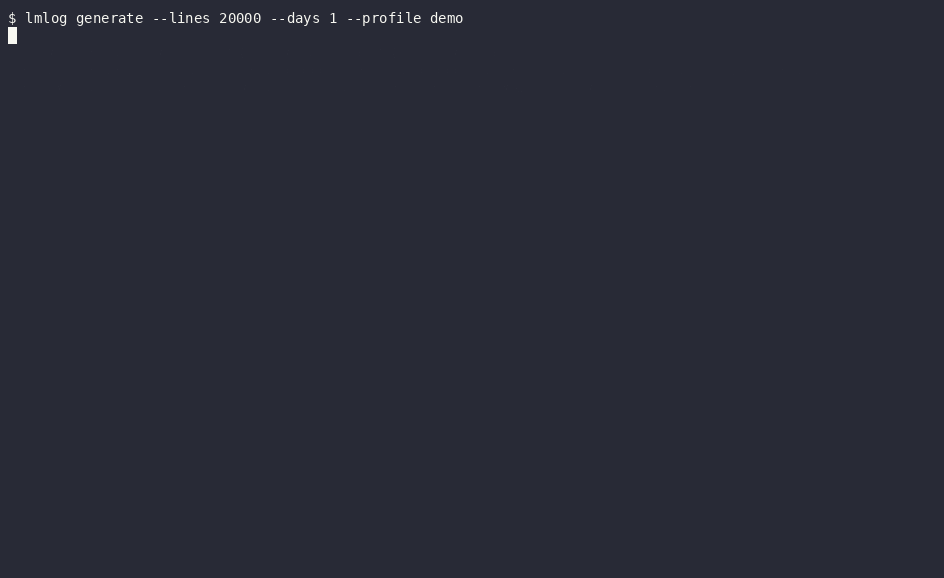
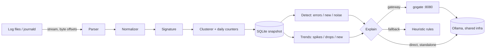

# lmlog

[](https://github.com/yugrinovD/lmlog/actions/workflows/ci.yml)
[](LICENSE)
[](https://github.com/yugrinovD/lmlog/releases)


**Local, CPU-first log intelligence: signatures, errors, anomalies and
explanations for very large log volumes.**

**Part of [AI Ops Stack](https://github.com/yugrinovD/ai-ops-stack):**
[gogate](https://github.com/yugrinovD/gogate) ·
[lmlog](https://github.com/yugrinovD/lmlog) ·
[ops-console](https://github.com/yugrinovD/ops-console) ·
[ledger](https://github.com/yugrinovD/ledger) ·
[ai-ops-stack](https://github.com/yugrinovD/ai-ops-stack).

[Русская версия](README.md) · [Changelog](CHANGELOG.md)

I built it after spending another half-day in `grep` over gigabytes of logs and
finding the actual error by accident. The idea was to collapse the stream into a
few dozen signatures first, and only then look at what matters.

`lmlog` needs no GPU, sends no data outside the host and works in air-gapped
environments. It is designed for 50M+ lines a day, but 12M on a laptop is fine
too.

## Why

In boxed deployments of large PHP/Symfony applications, almost all log volume is
noise. Tens of millions of identical INFO lines a day, and a few real errors
somewhere in the middle.

`lmlog` does three things:

1. **Reduces** millions of lines into dozens of unique signatures with frequency
   and trend.
2. **Detects** errors, new patterns, spikes and patterns that went silent.
3. **Explains** findings with a local LLM or a deterministic heuristic.



Reproduce the recording: `bash docs/demo.sh` (requires `lmlog` in `PATH`).

## Features

- **Streaming ingest** — memory does not grow with the number of lines; no list
  of entries is materialised.
- **Exact offsets + inode** — correct incremental reads and rotation detection.
- **Normalisation** — UUIDs, numbers, IPs, hashes and timestamps collapse into
  typed tokens.
- **Parallel parsing** — `--workers N` across files and cores.
- **Detection** — error clusters, new signatures, high-volume noise, spikes and
  drops.
- **LLM through a gateway** — `gogate` by default; `direct` is kept for standalone
  Ollama development.
- **HTTP API** — `lmlog serve` for the web console: upload, SSE progress,
  snapshots, explain and chat.
- **Zero mandatory dependencies** — Python standard library only; `orjson` is
  picked up if installed.

## Architecture



The heavy `ingest` pass reads files and saves a cluster snapshot to SQLite. All
queries (`scan`, `errors`, `trends`, `explain`) work from the snapshot and answer
instantly. The daemon only reads new bytes.

## Quick start

Docker:

```bash
cp .env.example .env
make demo
```

`make demo` builds the image, generates synthetic logs, runs `ingest` and shows
the findings.

Locally:

```bash
python3 -m venv .venv
source .venv/bin/activate
pip install -e ".[dev]"

lmlog generate --lines 200000 --days 1 --profile demo
lmlog ingest
lmlog errors
lmlog explain --no-llm
```

State lives in `~/.lmlog/lmlog.db` by default; logs are read from `data/logs`.
Change that with `--log-dir` or `LMLOG_LOG_DIR`.

### Commands

| Command | What it does |
| --- | --- |
| `lmlog` / `lmlog wizard` | interactive assistant |
| `lmlog generate` | synthetic logs for demos |
| `lmlog ingest` | read logs and save a snapshot |
| `lmlog scan` | errors, new and frequent patterns |
| `lmlog errors` | ERROR/CRITICAL clusters |
| `lmlog classes <name>` | search by class/namespace |
| `lmlog trends` | spikes, drops and new patterns |
| `lmlog explain` | LLM or heuristic explanations |
| `lmlog daemon` | background incremental ingest |
| `lmlog serve` | HTTP API for the console |
| `lmlog bench` | throughput measurement |

Full help: `lmlog <command> --help`.

## HTTP API

`serve` is not part of the base install:

```bash
pip install -e ".[serve]"
export LMLOG_API_TOKEN="$(openssl rand -hex 32)"
lmlog serve --host 127.0.0.1 --port 8090
```

The token is required and compared in constant time.

| Method | Path | Purpose |
| --- | --- | --- |
| `POST` | `/api/v1/jobs` | upload `.log/.txt/.jsonl` (≤ 50 MB) and start ingest |
| `GET` | `/api/v1/jobs/{id}` | job status |
| `GET` | `/api/v1/jobs/{id}/events` | SSE progress |
| `GET` | `/api/v1/snapshots/{id}/summary` | snapshot summary |
| `GET` | `/api/v1/snapshots/{id}/signatures` | signatures |
| `GET` | `/api/v1/snapshots/{id}/errors` | error clusters |
| `GET` | `/api/v1/snapshots/{id}/trends` | trends |
| `POST` | `/api/v1/explain` | explain a cluster |
| `POST` | `/api/v1/chat` | grounded question over a snapshot |
| `GET` | `/healthz` | liveness, no auth |

Jobs and SSE queues live in process memory, so run a single uvicorn worker. Chat
does not use RAG: the model sees the summary, top-N signatures, the selected
cluster and recent trends. If `gogate` is down, explanations fall back to the
heuristic; ingest/scan/trends keep working.

## Performance

On a synthetic stress profile, one process, an ordinary dev machine:

```text
$ lmlog bench --lines 1000000
Throughput      : ~85 000 lines/s
50M lines at this rate: ~9.8 min
```

Ingest is streaming: memory depends on the number of unique signatures, not the
number of lines. SQLite runs in WAL mode with batched inserts; `orjson` is
optional.

## LLM: gateway and direct

By default `lmlog` calls `gogate` over the OpenAI-compatible API. That keeps
retries, timeouts, limits, cache and metrics in one place.

```dotenv
# full stack
LMLOG_LLM_MODE=gateway
GOGATE_BASE_URL=http://gogate:8080
GOGATE_API_KEY=<key from gogate>

# standalone without gogate
LMLOG_LLM_MODE=direct
OLLAMA_HOST=ollama:11434
```

```bash
make ai-up
LMLOG_LLM_MODE=direct lmlog explain
lmlog explain --no-llm       # heuristic only
lmlog explain --refresh      # ignore the cache
```

If the gateway or the model is unavailable, `lmlog` returns `source=heuristic`
and does not break ingest/scan/trends. Explanations are cached per signature in
SQLite.

## Limitations

- Tuned for structured Monolog logs. Arbitrary text is treated as a message
  without context.
- journald is available only where `journalctl` exists.
- The LLM explains dozens of unique patterns, not a stream of lines. That is
  intentional.
- SQLite is the single state store; it assumes one host and one log set.
- Rotation or truncation in incremental mode rebuilds all files in `log_dir`.
- Compressed `*.gz` files are not read.
- Copytruncate can be missed if the file grows back to its previous size between
  checks.

## Docs

- [DESIGN.md](docs/DESIGN.md) — architecture and decisions
- [demo.sh](docs/demo.sh) — recording script
- [CHANGELOG.md](CHANGELOG.md) — version history

## License

MIT. See [LICENSE](LICENSE).
