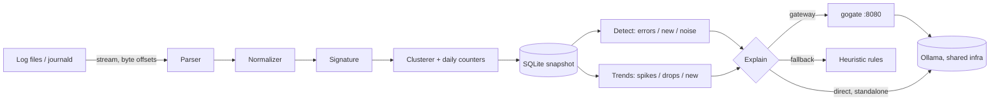

# lmlog

[](https://github.com/yugrinovD/lmlog/actions/workflows/ci.yml)
[](LICENSE)


**Local, CPU-first log intelligence: signatures, errors, anomalies and explanations for very large log volumes.**

**Part of [AI Ops Stack](https://github.com/yugrinovD/ai-ops-stack):**
[gogate](https://github.com/yugrinovD/gogate) ·
[lmlog](https://github.com/yugrinovD/lmlog) ·
[ops-console](https://github.com/yugrinovD/ops-console) ·
[ledger](https://github.com/yugrinovD/ledger) ·
[ai-ops-stack](https://github.com/yugrinovD/ai-ops-stack).

`lmlog` turns millions of structured log lines into a small set of readable
signatures, detects errors, new patterns and anomalies from daily history, and
explains findings in plain language — deterministically or with a local LLM.

It targets **50M+ log lines per day**, needs no GPU, sends no data outside the
host and works in air-gapped environments.

[Русская версия](README.md)

---

## Why

In boxed deployments of large PHP/Symfony applications most log volume is noise:
tens of millions of repeated INFO lines per day. Real errors get lost, and
grepping through gigabytes of files does not scale.

`lmlog` solves three problems:

1. **Reduction**: millions of lines → dozens of unique signatures with frequency
   and trend.
2. **Detection**: errors, new patterns, abnormal growth and patterns that went
   silent.
3. **Explanation**: a local LLM or a deterministic heuristic fallback answers
   what is happening, how critical it is and what to check.

## Features

- **Streaming ingest** — memory does not grow with the number of lines; no list
  of entries is ever materialised.
- **Exact byte offsets + inode** — correct incremental reads and rotation
  detection.
- **Normalisation** — UUIDs, numbers, IPs, hashes and timestamps collapse into
  typed tokens.
- **Parallel parsing** — `--workers N` across files/cores.
- **Detection** — error clusters, new signatures, high-volume noise, spikes and
  drops.
- **Daily trends** — `daily_counts` in SQLite with a median baseline.
- **LLM through a gateway** — by default `lmlog` calls `gogate` over the
  OpenAI-compatible API; the standalone `direct` mode keeps native Ollama
  access. Explanations are cached in SQLite and fall back to heuristics when no
  LLM is available.
- **Log generator** — realistic synthetic stream for demos and benchmarks.
- **Docker + Compose** — generator, CLI, daemon and an optional standalone
  Ollama `ai` profile.
- **Zero mandatory dependencies** — standard library only; `orjson` is picked up
  automatically if installed.

## Architecture



The heavy pass (`ingest`) reads files and stores a cluster snapshot in SQLite.
All queries (`scan`, `errors`, `trends`, `explain`) read the snapshot and are
instant. The `lmlog daemon` process periodically reads only new bytes and keeps
the snapshot fresh.

## Quick start: Docker

```bash
cp .env.example .env
make demo
```

`make demo` builds the image, generates synthetic logs, runs `ingest` and shows
findings and error clusters.

Useful targets:

```bash
make generate     # generate logs (LMLOG_DEMO_LINES, LMLOG_DEMO_DAYS)
make ingest       # read logs and save a snapshot
make scan         # findings
make errors       # error clusters
make explain      # explanations (heuristic, no LLM required)
make trends       # anomalies from history
make daemon-up    # background incremental ingest
make bench        # measure throughput
make ai-up        # standalone-dev: start Ollama and pull the model
make pull-model   # pull the model only
make down         # stop services
```

Manual container usage:

```bash
docker compose run --rm lmlog ingest
docker compose run --rm lmlog scan
docker compose run --rm lmlog errors
docker compose run --rm lmlog explain --no-llm
```

## Quick start: local

```bash
python3 -m venv .venv
source .venv/bin/activate
pip install -e ".[dev]"

# 1. Generate demo logs into data/logs
lmlog generate --lines 200000 --days 1 --profile demo

# 2. Read logs and save a snapshot
lmlog ingest

# 3. Instant queries over the snapshot
lmlog scan
lmlog errors
lmlog classes Handler
lmlog explain --no-llm
```

State lives in `~/.lmlog/lmlog.db` by default; logs are read from `data/logs`
(override with `--log-dir` / `LMLOG_LOG_DIR`).

### Example output

```text
$ lmlog ingest
Ingest finished: files=1, lines=200 000, entries=200 000, signatures=12,
time=2.2s (90 415 lines/s).
Snapshot saved. `scan`, `errors`, `classes` and `explain` now read from it instantly.

$ lmlog errors -n 3
ERROR clusters: 6

======================================================================
errors=1189  total=1 189  first=2026-08-25T00:00:31  last=2026-08-25T23:59:43
  msg: Failed request to Storage {method} {url} {statusCode}
======================================================================
errors=419  total=419  first=2026-08-25T00:02:32  last=2026-08-25T23:55:38
  msg: Storage Disk Space Error:Cannot complete Storage request in 3 attempts
======================================================================
errors=410  total=410  first=2026-08-25T00:02:35  last=2026-08-25T23:53:49
  classes: App\Infrastructure\Repository\SampleRepository
  msg: Uncaught PHP Exception Doctrine\DBAL\Exception\IntegrityConstraintViolationException
```

## Portfolio demo scenario

1. **Generate**: `lmlog generate --lines 200000 --days 7 --profile demo` — seven
   days of realistic flow (noise + recurring errors). For multi-day demos the
   generator deliberately injects an error spike, a silent consumer and a new
   pattern, so `trends` shows meaningful output immediately (`--no-anomaly`
   disables this).
2. **Ingest**: `lmlog ingest` — snapshot and daily history.
3. **Triage**: `lmlog scan` and `lmlog errors` — errors, new patterns, noise.
4. **Trends**: `lmlog trends` — spikes, silent patterns, new templates.
5. **Explain**: `lmlog explain --no-llm` — structured heuristics; with
   `make ai-up` and `LMLOG_LLM_MODE=direct` — local model explanations; in the
   full stack — through `gogate`.
6. **Daemon**: `make daemon-up` — background refresh every 5 minutes.
7. **Benchmark**: `lmlog bench --lines 1000000` — throughput.

## Commands

| Command | Purpose |
| --- | --- |
| `lmlog` / `lmlog wizard` | Interactive assistant |
| `lmlog generate` | Generate synthetic logs |
| `lmlog ingest` | Read logs and save a snapshot |
| `lmlog scan` | Findings: errors, new and frequent patterns |
| `lmlog errors` | ERROR/CRITICAL clusters |
| `lmlog classes <name>` | Search by class/namespace |
| `lmlog explain` | Explanations (LLM or heuristic) |
| `lmlog trends` | Proactive trends from daily history |
| `lmlog status` / `summary` | Current situation |
| `lmlog daemon` | Background incremental ingest |
| `lmlog serve` | HTTP API (requires the `serve` extra and a token) |
| `lmlog bench` | Throughput measurement |
| `lmlog journal` | System journal (if `journalctl` is available) |

Full help: `lmlog <command> --help`.

## HTTP API: `lmlog serve`

For web consoles there is an optional HTTP mode. It is not part of the default install:

```bash
pip install -e ".[serve]"
export LMLOG_API_TOKEN="$(openssl rand -hex 32)"
lmlog serve --host 127.0.0.1 --port 8090
```

Docker:

```bash
LMLOG_API_TOKEN="$(openssl rand -hex 32)" make serve
```

The API requires `Authorization: Bearer ${LMLOG_API_TOKEN}` (constant-time comparison).
The token is mandatory; the service refuses to start without it.

| Method | Path | Purpose |
| --- | --- | --- |
| `POST` | `/api/v1/jobs` | upload `.log/.txt/.jsonl` (≤ 50 MiB) and start ingest |
| `GET` | `/api/v1/jobs` | recent jobs |
| `GET` | `/api/v1/jobs/{id}` | job status and statistics |
| `GET` | `/api/v1/jobs/{id}/events` | SSE progress with `Last-Event-ID` |
| `GET` | `/api/v1/snapshots/{id}/summary` | snapshot overview |
| `GET` | `/api/v1/snapshots/{id}/signatures` | signatures with filters and pagination |
| `GET` | `/api/v1/snapshots/{id}/errors` | ERROR/CRITICAL clusters |
| `GET` | `/api/v1/snapshots/{id}/trends` | spikes, drops and new patterns |
| `POST` | `/api/v1/explain` | explain a cluster (LLM or heuristic) |
| `POST` | `/api/v1/chat` | ask about a snapshot: top-N signatures + selected cluster |
| `GET` | `/healthz` | liveness without auth, LLM mode and model |

`serve` limitations:

- jobs and SSE subscribers live in process memory; run a single uvicorn worker;
- uploads and SQLite snapshots are stored in `LMLOG_SERVE_DATA_DIR`
  (default `~/.lmlog/serve`);
- chat is not RAG: the model only sees the summary, top-N signatures, the selected
  cluster and the latest trends;
- when `gogate` (or Ollama behind it) is unavailable, explanations and chat fall
  back to deterministic heuristics; ingest/scan/trends keep working;
- filenames are sanitised and storage always uses a generated name;
- the upload limit is 50 MiB by default; allowed extensions are `.log`, `.txt` and `.jsonl`.

## Data correctness

- `clusters` is a signature catalog: **every full ingest rebuilds all files in
  `log_dir`** (the `--since`/`--limit` filters are ignored for it), while
  incremental ingest adds only the delta of the new pass. Re-running a full
  ingest is idempotent.
- If a rotated or truncated file is detected during incremental ingest, `lmlog`
  rebuilds the snapshot from **all** files in `log_dir`. This is more expensive
  but prevents double counting.
- Version 1.0.0 databases are rebuilt automatically on the first `ingest`
  (schema migration 1 → 2).
- Timestamps are compared in UTC, so offsets (`+03:00`, `Z`) do not break
  `first_seen`/`last_seen` ordering.
- Physical lines and successfully parsed entries are counted separately, so
  malformed lines remain visible without inflating throughput.

## Scale and performance

`lmlog` is designed for **50M+ lines per day**:

- streaming ingest: memory depends on the number of unique signatures, not on
  the number of lines;
- binary file reads with byte offsets and inode tracking;
- SQLite in WAL mode with batched `executemany` writes;
- optional multi-process parsing (`--workers N`);
- optional `orjson` acceleration for JSON parsing.

Measurement on a synthetic stress profile (single process, regular dev machine):

```text
$ lmlog bench --lines 1000000
Throughput      : ~85 000 lines/s
50M lines at this rate: ~9.8 min
```

Numbers depend on hardware, line format and JSON share. This is a reference
point, not a hard capacity limit: the tool is built for tens of millions of
lines per day.

## Log format

Symfony/Monolog is supported:

```text
[2026-08-25T11:44:54.253480+00:00] app.INFO: message {"context"} {"extra"}
```

- `context` may contain `class` — the application namespace.
- `extra` often contains `uid`.
- systemd journal is read through `journalctl` when available (optional).

Default file patterns: `console-*.log`, `prod-*.log`, `courses_console-*.log`,
`*.log`. The directory is set with `--log-dir` or `LMLOG_LOG_DIR`.

## LLM: gateway and direct

`lmlog` does not own the LLM infrastructure. By default it calls `gogate` over
the OpenAI-compatible API (`/v1/chat/completions`), and `gogate` talks to
Ollama. This keeps retries, timeouts, limits, cache, metrics and cost in one
place.

```dotenv
# Full stack (recommended)
LMLOG_LLM_MODE=gateway
GOGATE_BASE_URL=http://gogate:8080
GOGATE_API_KEY=<key created in gogate>

# Standalone development without gogate
LMLOG_LLM_MODE=direct
OLLAMA_HOST=ollama:11434
```

```bash
make ai-up                   # standalone-dev: profile ai + ollama pull
LMLOG_LLM_MODE=direct lmlog explain
lmlog explain                # gateway by default
lmlog explain --no-llm       # heuristics only
lmlog explain --refresh      # ignore the cache
```

When the gateway or the model is unavailable, `lmlog` returns
`source=heuristic` and keeps ingest/scan/trends working. Explanations are
cached per signature in SQLite.

> **Migration note:** `lmlog` used to call Ollama directly by default. The new
> default is `gateway`. Set `LMLOG_LLM_MODE=direct` for the old behaviour (the
> standalone Compose file does this automatically).

> The standalone `ai` profile and the full stack are mutually exclusive: do not
> run two Ollama containers at once (double RAM and a `11434` port conflict).
> Use `ai-ops-stack/` for the full stack.

## Configuration

| Variable | Default | Description |
| --- | --- | --- |
| `LMLOG_HOME` | `~/.lmlog` | State directory (daemon pid/log) |
| `LMLOG_DB` | `$LMLOG_HOME/lmlog.db` | SQLite path |
| `LMLOG_LOG_DIR` | `data/logs` | Log directory |
| `LMLOG_LLM_MODE` | `gateway` | `gateway` (gogate) or `direct` (Ollama) |
| `LMLOG_MODEL` | `qwen2.5:3b` | Model in the gateway or Ollama |
| `GOGATE_BASE_URL` | `http://127.0.0.1:8080` | gogate public listener |
| `GOGATE_API_KEY` | — | Gateway API key |
| `GOGATE_API_KEY_FILE` | — | Key file (Docker secrets) |
| `OLLAMA_HOST` | `127.0.0.1:11434` | Ollama endpoint, `direct` only |
| `NO_COLOR` | — | Disable ANSI colours |

## Development

```bash
pip install -e ".[dev]"
pytest
ruff check .
lmlog bench --lines 1000000
```

CI: GitHub Actions, Python 3.10–3.13, lint + tests.

## Project layout

```text
src/lmlog/
  parser.py      # Monolog parsing
  normalize.py   # normalisation and signatures
  cluster.py     # clustering and statistics
  ingest.py      # streaming file and journald reads
  state.py       # SQLite: offsets, snapshot, history, cache
  detect.py      # errors, new patterns, trends
  explain.py     # heuristic explanations
  llm.py         # gogate (gateway) and Ollama (direct) clients
  generator.py   # synthetic log generator
  config.py      # configuration and environment
  cli.py         # command line interface
  serve/         # optional FastAPI HTTP API
  wizard.py      # interactive mode
  daemon.py      # background refresh
tests/           # pytest
examples/        # sample log
```

## Limitations

- Optimised for structured Monolog logs; arbitrary text is treated as a message
  without context.
- journald requires `journalctl` (optional inside containers).
- A CPU LLM explains dozens of unique templates, not the line stream — this is a
  deliberate architectural choice.
- SQLite is a single state store; this is sufficient for one host and one log set.
- Rotation during incremental ingest triggers a rebuild of all files in
  `log_dir` (a full pass); `--since`/`--limit` are ignored for full/rebuild.
- Copytruncate, where a file is truncated and grows back to its previous size
  between checks, may be missed. Rename/create rotation or a size decrease
  between checks is more reliable.
- Compressed `*.gz` files are not read; a warning is printed only when the name
  matches the log patterns.

## License

MIT. See [LICENSE](LICENSE).
