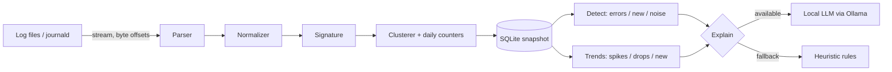

# lmlog

**Локальный CPU-first анализатор логов: сигнатуры, ошибки, аномалии и объяснения для очень больших объёмов.**

`lmlog` превращает миллионы строк структурированных логов в несколько десятков
понятных сигнатур, находит ошибки, новые шаблоны и аномалии по истории, а затем
объясняет находки человеческим языком — детерминированно или через локальную LLM.

Проект рассчитан на **50 млн строк в сутки и больше**, не требует GPU, не
отправляет данные наружу и работает в изолированных (air-gapped) средах.

[English version](README.en.md)

---

## Зачем это нужно

В коробочных инсталляциях крупных PHP/Symfony-приложений основной поток логов —
это шум: десятки миллионов однотипных INFO-строк в сутки. На их фоне теряются
единичные реальные ошибки, а ручной `grep` по гигабайтам файлов не масштабируется.

`lmlog` решает три задачи:

1. **Редукция**: миллионы строк → десятки уникальных сигнатур с частотой и трендом.
2. **Детекция**: ошибки, новые шаблоны, аномальный рост и «замолчавшие» паттерны.
3. **Объяснение**: локальная LLM или эвристический fallback отвечает, что
   происходит, насколько это критично и что проверить.

## Ключевые возможности

- **Потоковый ingest** — память не растёт с объёмом логов; списки строк никогда
  не материализуются.
- **Точные байтовые offset + inode** — корректный инкрементальный дочитыв и
  обнаружение ротации файлов.
- **Шаблонизация** — UUID, числа, IP, хеши и timestamp'ы схлопываются в токены.
- **Параллельный парсинг** — `--workers N` для нескольких файлов/ядер.
- **Детекция** — ERROR-кластеры, новые сигнатуры, частый шум, всплески, спады.
- **Тренды по дням** — `daily_counts` в SQLite, медианная базовая линия.
- **Локальная LLM** — Ollama (CPU), кэш объяснений в SQLite; при недоступности
  модели автоматически используется эвристика.
- **Генератор логов** — реалистичный синтетический поток для демо и бенчмарков.
- **Docker + Compose** — генератор, CLI, демон и опциональный Ollama-профиль.
- **Ноль обязательных зависимостей** — только стандартная библиотека Python;
  `orjson` подхватывается автоматически, если установлен.

## Архитектура



Тяжёлый проход (`ingest`) читает файлы и сохраняет снимок кластеров в SQLite.
Все запросы (`scan`, `errors`, `trends`, `explain`) работают по снимку и
выполняются мгновенно. Демон `lmlog daemon` периодически дочитывает только новые
байты и держит снимок свежим.

## Быстрый старт: Docker

```bash
cp .env.example .env
make demo
```

`make demo` собирает образ, генерирует синтетические логи, выполняет `ingest`,
показывает находки и ERROR-кластеры.

Полезные команды:

```bash
make generate     # сгенерировать логи (LMLOG_DEMO_LINES, LMLOG_DEMO_DAYS)
make ingest       # прочитать логи и сохранить снимок
make scan         # находки
make errors       # ERROR-кластеры
make explain      # объяснения (эвристика, LLM не нужна)
make trends       # аномалии по истории
make daemon-up    # фоновый инкрементальный ingest
make bench        # замер пропускной способности
make llm          # поднять Ollama и скачать модель
make down         # остановить сервисы
```

Ручной запуск в контейнере:

```bash
docker compose run --rm lmlog ingest
docker compose run --rm lmlog scan
docker compose run --rm lmlog errors
docker compose run --rm lmlog explain --no-llm
```

## Быстрый старт: локально

```bash
python3 -m venv .venv
source .venv/bin/activate
pip install -e ".[dev]"

# 1. Сгенерировать демо-логи в data/logs
lmlog generate --lines 200000 --days 1 --profile demo

# 2. Прочитать логи и сохранить снимок
lmlog ingest

# 3. Мгновенные запросы по снимку
lmlog scan
lmlog errors
lmlog classes Handler
lmlog explain --no-llm
```

По умолчанию состояние хранится в `~/.lmlog/lmlog.db`, а логи читаются из
`data/logs` (переопределяется через `--log-dir` / `LMLOG_LOG_DIR`).

### Пример вывода

```text
$ lmlog ingest
Ingest finished: files=1, lines=200 000, entries=200 000, signatures=12,
time=2.2s (90 415 lines/s).
Snapshot saved. `scan`, `errors`, `classes` and `explain` now read from it instantly.

$ lmlog errors -n 3
ERROR clusters: 6

======================================================================
errors=1189  total=1 189  first=2026-08-25T00:00:31  last=2026-08-25T23:59:43
  msg: Failed request to Storage {method} {url} {statusCode}
======================================================================
errors=419  total=419  first=2026-08-25T00:02:32  last=2026-08-25T23:55:38
  msg: Storage Disk Space Error:Cannot complete Storage request in 3 attempts
======================================================================
errors=410  total=410  first=2026-08-25T00:02:35  last=2026-08-25T23:53:49
  classes: Infrastructure\Repository\EventTimetableRepository
  msg: Uncaught PHP Exception Doctrine\DBAL\Exception\IntegrityConstraintViolationException
```

## Демо-сценарий для портфолио

1. **Генерация**: `lmlog generate --lines 200000 --days 7 --profile demo` —
   семь дней реалистичного потока (шум + повторяющиеся ошибки). Для многодневного
   демо генератор специально добавляет всплеск ошибок, «замолчавший» консьюмер и
   новый шаблон — чтобы `trends` сразу показал осмысленный результат
   (`--no-anomaly` отключает это поведение).
2. **Ingest**: `lmlog ingest` — снимок и дневная история.
3. **Разбор**: `lmlog scan` и `lmlog errors` — ошибки, новые шаблоны, шум.
4. **Тренды**: `lmlog trends` — всплески, «замолчавшие» паттерны, новые шаблоны.
5. **Explain**: `lmlog explain --no-llm` — структурированные эвристики;
   с `make llm` и `lmlog explain` — объяснения локальной модели.
6. **Daemon**: `make daemon-up` — фоновое обновление снимка каждые 5 минут.
7. **Benchmark**: `lmlog bench --lines 1000000` — пропускная способность.

## Команды

| Команда | Назначение |
| --- | --- |
| `lmlog` / `lmlog wizard` | Интерактивный ассистент |
| `lmlog generate` | Сгенерировать синтетические логи |
| `lmlog ingest` | Прочитать логи и сохранить снимок |
| `lmlog scan` | Находки: ошибки, новые и частые шаблоны |
| `lmlog errors` | ERROR/CRITICAL-кластеры |
| `lmlog classes <name>` | Поиск по class/namespace |
| `lmlog explain` | Объяснения (LLM или эвристика) |
| `lmlog trends` | Проактивные тренды по истории дней |
| `lmlog status` / `summary` | Текущая ситуация |
| `lmlog daemon` | Фоновый инкрементальный ingest |
| `lmlog bench` | Замер пропускной способности |
| `lmlog journal` | Системный журнал (если доступен journalctl) |

Полная справка: `lmlog <command> --help`.

## Масштаб и производительность

`lmlog` спроектирован под **50M+ строк в сутки**:

- ingest потоковый: память зависит от числа уникальных сигнатур, а не от объёма
  строк;
- чтение бинарное, offset — байтовый, с учётом inode;
- SQLite в режиме WAL, батчевые вставки, `executemany`;
- при необходимости — параллельный парсинг нескольких файлов (`--workers N`);
- опционально `orjson` для ускорения разбора JSON.

Замер на синтетическом stress-профиле (один процесс, обычная dev-машина):

```text
$ lmlog bench --lines 1000000
Throughput      : ~90 000 lines/s
50M lines at this rate: ~9.2 min
```

Цифры зависят от железа, формата строк и доли JSON. Это не «потолок», а
ориентир: инструмент рассчитан на десятки миллионов строк в сутки, а не на
конкретный объём.

## Формат логов

Поддерживается Symfony/Monolog:

```text
[2026-08-25T11:44:54.253480+00:00] app.INFO: message {"context"} {"extra"}
```

- `context` может содержать `class` — namespace кода.
- `extra` часто содержит `uid`.
- Дополнительно (опционально) читается journald через `journalctl`.

Файлы по умолчанию: `console-*.log`, `prod-*.log`, `courses_console-*.log`, `*.log`.
Каталог задаётся через `--log-dir` или `LMLOG_LOG_DIR`.

## Локальная LLM

`lmlog explain` сначала пытается обратиться к Ollama, а при недоступности
переключается на эвристические объяснения — демо работает всегда.

```bash
make llm                     # docker compose profile llm + ollama pull
lmlog explain                # LLM, если доступна
lmlog explain --no-llm       # только эвристика
lmlog explain --refresh      # игнорировать кэш
```

Настройки: `OLLAMA_HOST` (по умолчанию `127.0.0.1:11434`), `LMLOG_MODEL`
(по умолчанию `qwen2.5:3b`). Объяснения кэшируются по сигнатуре в SQLite.

## Конфигурация

| Переменная | По умолчанию | Описание |
| --- | --- | --- |
| `LMLOG_HOME` | `~/.lmlog` | Каталог состояния (daemon pid/log) |
| `LMLOG_DB` | `$LMLOG_HOME/lmlog.db` | Путь к SQLite |
| `LMLOG_LOG_DIR` | `data/logs` | Каталог логов |
| `LMLOG_MODEL` | `qwen2.5:3b` | Модель Ollama |
| `OLLAMA_HOST` | `127.0.0.1:11434` | Адрес Ollama |
| `NO_COLOR` | — | Отключить ANSI-цвета |

## Разработка

```bash
pip install -e ".[dev]"
pytest
ruff check .
lmlog bench --lines 1000000
```

CI: GitHub Actions, Python 3.11/3.12, lint + tests.

## Структура проекта

```text
src/lmlog/
  parser.py      # разбор Monolog
  normalize.py   # шаблонизация и сигнатуры
  cluster.py     # кластеризация и статистика
  ingest.py      # потоковое чтение файлов и journald
  state.py       # SQLite: offsets, снимок, история, кэш
  detect.py      # ошибки, новые шаблоны, тренды
  explain.py     # эвристические объяснения
  llm.py         # клиент Ollama
  generator.py   # генератор синтетических логов
  cli.py         # CLI
  wizard.py      # интерактивный режим
  daemon.py      # фоновое обновление
tests/           # pytest
examples/        # пример лога
```

## Ограничения

- Ориентирован на структурированные Monolog-логи; произвольный текст
  обрабатывается как сообщение без контекста.
- journald доступен только там, где есть `journalctl` (в контейнере — опционально).
- Локальная LLM на CPU объясняет десятки уникальных шаблонов, а не поток строк —
  это осознанное архитектурное решение.
- SQLite — единая точка состояния; для одного хоста и одного набора логов этого
  достаточно.

## Лицензия

MIT. См. [LICENSE](LICENSE).
