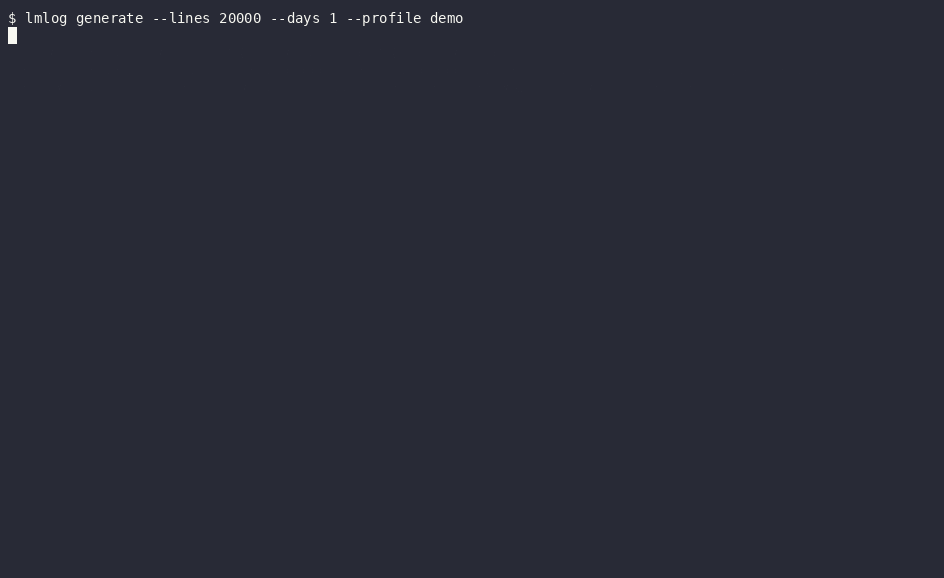
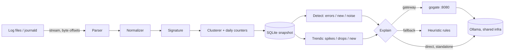

# lmlog

[](https://github.com/yugrinovD/lmlog/actions/workflows/ci.yml)
[](LICENSE)
[](https://github.com/yugrinovD/lmlog/releases)


**Локальный CPU-first анализатор логов: сигнатуры, ошибки, аномалии и
объяснения для очень больших объёмов.**

**Part of [AI Ops Stack](https://github.com/yugrinovD/ai-ops-stack):**
[gogate](https://github.com/yugrinovD/gogate) ·
[lmlog](https://github.com/yugrinovD/lmlog) ·
[ops-console](https://github.com/yugrinovD/ops-console) ·
[ledger](https://github.com/yugrinovD/ledger) ·
[ai-ops-stack](https://github.com/yugrinovD/ai-ops-stack).

[English version](README.en.md) · [Changelog](CHANGELOG.md)

Сделал его после того, как очередной раз провёл полдня в `grep` по гигабайтам
логов и всё равно нашёл ошибку случайно. Хотелось получить штуку, которая
сначала схлопывает поток в десятки сигнатур, а потом уже показывает, что в них
важного.

`lmlog` не требует GPU, не отправляет данные наружу и работает в air-gapped
средах. Рассчитан на 50M+ строк в сутки, но на ноутбуке с 12M тоже нормально
справляется.

## Зачем

В коробочных инсталляциях крупных PHP/Symfony-приложений почти весь объём логов
— шум. Десятки миллионов одинаковых INFO-строк в сутки, на фоне которых теряются
единичные ошибки.

`lmlog` делает три вещи:

1. **Схлопывает** миллионы строк в десятки уникальных сигнатур с частотой и
   трендом.
2. **Находит** ошибки, новые шаблоны, всплески и «замолчавшие» паттерны.
3. **Объясняет** находки: локальная LLM или детерминированная эвристика.



Воспроизвести запись: `bash docs/demo.sh` (нужен установленный `lmlog`).

## Что умеет

- **Потоковый ingest** — память не растёт с объёмом логов, списки строк не
  материализуются.
- **Точные offset + inode** — корректный incremental и обнаружение ротации.
- **Шаблонизация** — UUID, числа, IP, хеши и timestamp'ы схлопываются в токены.
- **Параллельный парсинг** — `--workers N` по файлам и ядрам.
- **Детекция** — ERROR-кластеры, новые сигнатуры, частый шум, всплески, спады.
- **LLM через gateway** — по умолчанию `gogate`; `direct` оставлен для
  standalone-разработки с Ollama.
- **HTTP API** — `lmlog serve` для веб-консоли: загрузка, SSE-прогресс, снимки,
  explain и чат.
- **Ноль обязательных зависимостей** — стандартная библиотека Python;
  `orjson` подхватывается, если установлен.

## Архитектура



Тяжёлый `ingest` читает файлы и сохраняет снимок кластеров в SQLite. Все запросы
(`scan`, `errors`, `trends`, `explain`) работают по снимку и отвечают мгновенно.
Демон периодически дочитывает только новые байты.

## Быстрый старт

Docker:

```bash
cp .env.example .env
make demo
```

`make demo` собирает образ, генерирует синтетические логи, делает `ingest` и
показывает находки.

Локально:

```bash
python3 -m venv .venv
source .venv/bin/activate
pip install -e ".[dev]"

lmlog generate --lines 200000 --days 1 --profile demo
lmlog ingest
lmlog errors
lmlog explain --no-llm
```

Состояние по умолчанию лежит в `~/.lmlog/lmlog.db`, логи читаются из `data/logs`.
Каталог меняется через `--log-dir` или `LMLOG_LOG_DIR`.

### Команды

| Команда | Что делает |
| --- | --- |
| `lmlog` / `lmlog wizard` | интерактивный ассистент |
| `lmlog generate` | синтетические логи для демо |
| `lmlog ingest` | прочитать логи и сохранить снимок |
| `lmlog scan` | ошибки, новые и частые шаблоны |
| `lmlog errors` | ERROR/CRITICAL-кластеры |
| `lmlog classes <name>` | поиск по class/namespace |
| `lmlog trends` | всплески, спады, новые шаблоны |
| `lmlog explain` | объяснения через LLM или эвристику |
| `lmlog daemon` | фоновый incremental ingest |
| `lmlog serve` | HTTP API для консоли |
| `lmlog bench` | пропускная способность |

Полная справка: `lmlog <command> --help`.

## HTTP API

`serve` не входит в базовую установку:

```bash
pip install -e ".[serve]"
export LMLOG_API_TOKEN="$(openssl rand -hex 32)"
lmlog serve --host 127.0.0.1 --port 8090
```

Токен обязателен, сравнение constant-time.

| Метод | Путь | Зачем |
| --- | --- | --- |
| `POST` | `/api/v1/jobs` | загрузить `.log/.txt/.jsonl` (≤ 50 МБ) и запустить ingest |
| `GET` | `/api/v1/jobs/{id}` | статус задания |
| `GET` | `/api/v1/jobs/{id}/events` | SSE-прогресс |
| `GET` | `/api/v1/snapshots/{id}/summary` | сводка снимка |
| `GET` | `/api/v1/snapshots/{id}/signatures` | сигнатуры |
| `GET` | `/api/v1/snapshots/{id}/errors` | ERROR-кластеры |
| `GET` | `/api/v1/snapshots/{id}/trends` | тренды |
| `POST` | `/api/v1/explain` | объяснить кластер |
| `POST` | `/api/v1/chat` | вопрос по снимку |
| `GET` | `/healthz` | liveness без авторизации |

Задания и SSE-очереди живут в памяти процесса, поэтому запускать нужно один
uvicorn-worker. Чат не использует RAG: модель видит сводку, top-N сигнатур,
выбранный кластер и последние тренды. При недоступном `gogate` объяснения
переключаются на эвристику, ingest/scan/trends продолжают работать.

## Производительность

На синтетическом stress-профиле, один процесс, обычная dev-машина:

```text
$ lmlog bench --lines 1000000
Throughput      : ~85 000 lines/s
50M lines at this rate: ~9.8 min
```

Ingest потоковый: память зависит от числа уникальных сигнатур, а не от объёма
строк. SQLite в WAL, батчевые вставки, опционально `orjson`.

## LLM: gateway и direct

По умолчанию `lmlog` вызывает `gogate` по OpenAI-совместимому API. Так
retry, таймауты, лимиты, кэш и метрики живут в одном месте.

```dotenv
# полный стек
LMLOG_LLM_MODE=gateway
GOGATE_BASE_URL=http://gogate:8080
GOGATE_API_KEY=<ключ из gogate>

# standalone без gogate
LMLOG_LLM_MODE=direct
OLLAMA_HOST=ollama:11434
```

```bash
make ai-up
LMLOG_LLM_MODE=direct lmlog explain
lmlog explain --no-llm       # только эвристика
lmlog explain --refresh      # игнорировать кэш
```

Если gateway или модель недоступны, `lmlog` возвращает `source=heuristic` и не
ломает ingest/scan/trends. Объяснения кэшируются по сигнатуре в SQLite.

## Ограничения

- Ориентирован на структурированные Monolog-логи. Произвольный текст
  обрабатывается как сообщение без контекста.
- journald доступен только там, где есть `journalctl`.
- LLM объясняет десятки уникальных шаблонов, а не поток строк. Это осознанно.
- SQLite — единая точка состояния, расчёт на один хост и один набор логов.
- При ротации/усечении в incremental-режиме пересобираются все файлы `log_dir`.
- Сжатые `*.gz` не читаются.
- Copytruncate может не обнаружиться, если файл успел вырасти до прежнего размера
  между проверками.

## Документация

- [DESIGN.md](docs/DESIGN.md) — архитектура и решения
- [demo.sh](docs/demo.sh) — сценарий записи demo
- [CHANGELOG.md](CHANGELOG.md) — история версий

## Лицензия

MIT. См. [LICENSE](LICENSE).
